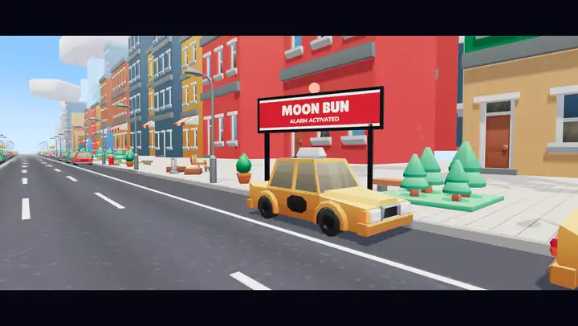

<div align="center">

# Trackbound: Pursuit

**A thief just robbed the bakery. You're the cop.**

A story-driven 3D police chase that runs in your browser. Run the suspect down, wear him out, and make the arrest yourself.

[](https://trackbound.vercel.app)


[](https://github.com/subramanyaSgb/trackbound/raw/main/docs/media/trackbound-pursuit.mp4)

**[Watch the trailer with sound (20 s, MP4)](https://github.com/subramanyaSgb/trackbound/raw/main/docs/media/trackbound-pursuit.mp4)** · **[Play in your browser](https://trackbound.vercel.app)**

</div>

---

## What it is

Trackbound: Pursuit is a three-lane chase game with a beginning, a middle and an arrest. Every case opens with a robbery. The suspect is a real runner on the same road as you: he dodges traffic, looks back, trips, throws debris and sometimes has a getaway bike waiting. Clean running closes the gap, crashes let him pull away, and the case only ends when you catch him.

It is mobile-first, installs as an app, and works offline after the first load. No account, no download.

## Features

- **Six story cases plus Free Patrol.** Each case has its own criminal, route and finale. A boss case unlocks after 100,000 m of lifetime pursuit. Free Patrol is an endless score-attack mode.
- **A suspect you actually chase.** The gap at the top of the screen is simulated, not scripted. Stay on his heels and his stamina drains; when it is empty, the final pursuit begins.
- **A playable arrest.** Get in range, line up in his lane, and fire inside the green window of the timing meter. Taser, net launcher or tackle, depending on the case.
- **Eight environments.** City streets, rail yards, tunnels, back alleys, an industrial yard, an expressway and suspension bridge, night roadworks and night docks, each with its own traffic, obstacles, lighting and sound.
- **Six heroes, six powers.** Police motorcycle, flight, speed dash, shield, route scan and wrecking charge. Coins charge the power; using it never spends them.
- **Checkpoints and hearts.** Every zone is a checkpoint. Three hearts per zone instead of one-hit failure.
- **Coaching built in.** A one-sentence card explains each mechanic the first time it appears, and a "How to play" guide sits behind the `?` button.
- **Installable and self-updating.** The home screen shows the running version, and the app tells you when a newer build is ready without interrupting a run.

## How to play

1. **Chase without crashing.** Change lanes, jump barriers, slide under gates. Each crash costs a heart and lets the thief get away a little.
2. **Tire him out.** After a short chase a red stamina bar appears. Stay right behind him and it empties.
3. **Make the arrest.** Run close, move into his lane, and fire when the white line is on green.

| | Touch | Keyboard |
|---|---|---|
| Change lane | swipe left / right | arrows or A / D |
| Jump | swipe up | up, W or Space |
| Slide | swipe down | down or S |
| Power / fire the capture tool | tap the round button | E, F, Enter or Shift |
| Pause | pause button | Esc or P |

Swiping down in mid-air drops into a slide, and a jump pressed just before landing is buffered. Tap anywhere to skip the intro.

## Quick start

Requires Node.js 20 or newer.

```bash
git clone https://github.com/subramanyaSgb/trackbound.git
cd trackbound
npm install
npm run dev        # dev server; prints a LAN URL you can open on your phone
```

| Command | What it does |
|---|---|
| `npm run dev` | Development server with hot reload |
| `npm run build` | Type-check and build the production site into `dist/` |
| `npm run preview` | Serve the production build (service worker active) |
| `npm test` | Unit tests |
| `npm run test:e2e` | End-to-end run in a real browser, against the production build |

`dist/` is a static site with relative paths, so it deploys to any static host. Installing as an app and offline play need HTTPS (or localhost).

## Testing

```bash
npm test                                       # 25 unit tests
npm run build && npm run test:e2e              # 61 end-to-end checks, desktop and phone-sized touch
npm run build && node tools/update-test.mjs    # the app update path, across two real builds
```

The unit tests cover track fairness (there is always a survivable path), the pursuit gap, suspect stamina, ability charging, the capture sequence, content data and save migration. The end-to-end run drives real input through menus, the intro, collisions, checkpoints, abilities, the capture finale, persistence and offline play. Set `CHROME=/path/to/browser` if no browser is found.

For visual checks, `node tools/shots.mjs <outDir> <scenario.mjs> [width] [height]` runs a scripted scenario and saves screenshots, and `tools/viewer.html` (dev server only) shows any model bundle or character pose.

## How it is built

```
src/data        All content: abilities, heroes and criminals, cases, seasons
src/core        Game (state machine and run flow), Assets, Bend (curved-world shader),
                Updates (version and update flow), Save (IndexedDB), Input, config
src/player      Rig (skinned character with procedural layers), Player (controller and poses)
src/pursuit     Pursuit (gap, hearts, stamina), Criminal (suspect AI), Capture (the finale)
src/abilities   Abilities (charge, activate, cooldown)
src/camera      FollowCamera (menu, chase, flight, motorcycle, cinematic and results poses)
src/world       generator (validated track), Spawner, ObstacleFactory, World (environment
                streaming), themes (eight environments), Sky, textures
src/systems     Collision, Coins, PowerUps, Missions (bounties), Particles
src/audio       AudioManager (synthesised effects, ambience and music)
src/ui          HUD, menus, sheets, captions and results
tools/          Asset pipeline, end-to-end and update tests, screenshot harness, model viewer
```

A few things worth knowing:

- **Content is data.** A new case, hero, criminal or season is an edit in `src/data`, with no engine changes.
- **The road curves on screen only.** The simulation runs on a straight track; a shader bends the world so the road sweeps, climbs and dips while collision and spawning stay exact.
- **Rules are plain, testable code.** The pursuit gap, capture sequence, ability charge and track generator have no rendering in them, which is why they can be unit-tested.
- **One animation set drives every character.** Five bodies share 35 clips, and looks are defined as recolour rules plus accessories.

### Adding content

| To add | Edit |
|---|---|
| A case (criminal, route, difficulty, capture rules, rewards, unlock gate) | `src/data/missions.ts` |
| A hero or criminal (body, colours, accessories, movement style, ability) | `src/data/characters.ts` |
| An ability's numbers (cost, duration, cooldown, speed) | `src/data/abilities.ts` |
| A season (dates, heroes, featured cases, reward track) | `src/data/seasons.ts` |
| An environment (scenery, lighting, obstacle set) | `src/world/themes.ts` |
| An obstacle or vehicle model | `src/world/ObstacleFactory.ts` |

A new ability *effect*, as opposed to new numbers, also needs its behaviour in `Game.power` and `Game.onHit`.

## Versions and updates

Every build is stamped with the `package.json` version, the git commit and the build time. The home screen shows it under the coin counter, for example `v0.2.0 (54ccd7f) · latest`, and Settings has a Version row with a CHECK button.

An installed copy runs from its cache, so it keeps playing the build it has until a newer one is downloaded and accepted:

1. On launch, on returning to the app, and on CHECK, the game reads `version.json` from the server and compares it with its own stamp.
2. If the server has a newer build, it downloads in the background and an UPDATE button appears. A pursuit in progress is never interrupted.
3. Tapping UPDATE switches to the new build and reloads. Offline, the game still starts and says it could not check.

## Assets and credits

All third-party models are CC0 (public domain): characters and city props by **Kay Lousberg** (KayKit), and vehicles, trees and coins by **Kenney**. Fonts are Lilita One and Nunito under the SIL Open Font License. The characters as they appear, the train, roads, structures, obstacles, signage, interface and all audio were made for this game. Audio is synthesised at run time; there are no audio files.

Season 1 is superhero-themed with original heroes. No licensed names, logos or likenesses are used.

Full sources and licences are in [ASSETS.md](ASSETS.md). To rebuild `public/models` from the source packs, clone the packs listed there into one folder and run `node tools/build-assets.mjs <folder>`.

The trailer above was made from live gameplay with the [`/brag`](https://github.com/latent-spaces/brag) skill.

## Known limitations

- The art is stylised low-poly, built from free packs and recoloured in code. It is not realistic and the characters are not bespoke models.
- Roads curve visually; there are no true turns or branching routes.
- Audio is synthesised, not recorded.
- Seasons 2 and 3 are placeholders; only Season 1 has content.
- It has not been tested on a physical phone, and balance has only been tuned against an autopilot.

[REDESIGN.md](REDESIGN.md) has the full audit, what was built, and the complete gap list.

## Licence

No licence file has been added yet, so the game's own code is all rights reserved by default. Third-party assets keep their own licences, listed in [ASSETS.md](ASSETS.md).
